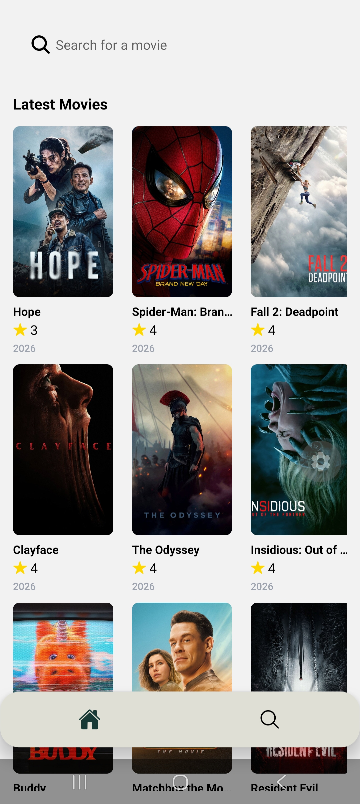
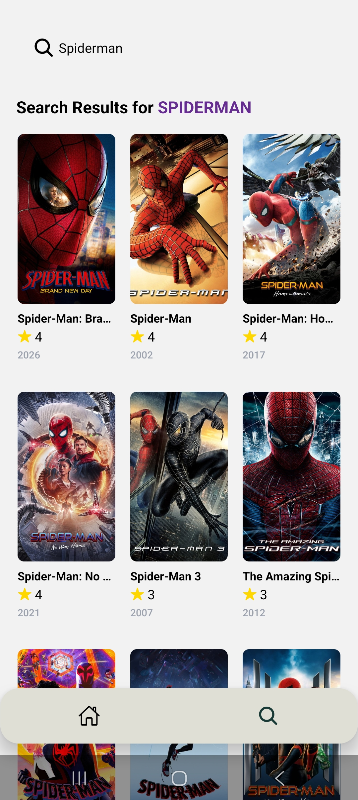

# 🎬 Movie Discovery App

[](https://github.com/your-username/your-repo)
[](https://opensource.org/licenses/MIT)

A modern, cross-platform mobile application built with React Native and Expo for discovering, searching, and tracking popular movies.

## ✨ Features

*   **🍿 Trending Movies:** Automatically displays a list of popular movies fetched from the TMDB API.
*   **🔍 Advanced Search:** Real-time search functionality with performance-optimized queries to find movies quickly.
*   **🎬 Movie Details:** A comprehensive view for each movie, including ratings, overviews, and cast information.
*   **📊 User Metrics:** Backend integration with Appwrite to track search activity and user interactions.

## 🚀 Tech Stack

*   **React Native:** A framework for building native apps using React.
*   **Expo:** A platform for making universal React applications.
*   **TypeScript:** A typed superset of JavaScript that compiles to plain JavaScript.
*   **Tailwind CSS (NativeWind):** A utility-first CSS framework for rapidly building custom designs.
*   **Appwrite:** A backend platform for building web, mobile, and flutter applications.
*   **TMDB API:** The Movie Database (TMDb) is a community-built movie and TV database.

## 📸 Screenshots

*(Add your screenshots here)*




## 📦 Installation

1.  **Prerequisites:** Ensure you have Node.js and npm installed on your machine.
2.  **Clone the repository:**
    ```bash
    git clone https://github.com/your-username/your-repo.git
    ```
3.  **Install dependencies:**
    ```bash
    npm install
    ```
4.  **Environment Setup:** Create a `.env` file in the root directory and add your Appwrite and TMDB API keys:
    ```
    APPWRITE_API_KEY=your_appwrite_api_key
    TMDB_API_KEY=your_tmdb_api_key
    ```
5.  **Start the App:**
    ```bash
    npx expo start
    ```
    Then, scan the QR code using the Expo Go app on your phone.

## 🕹️ Usage

To run the application in development mode, use the following command:

```bash
npx expo start
```

Use the bottom navigation to switch between the **Home**, **Search**, and **Saved** screens.

## 🤝 Contributing

We welcome contributions to improve this project! Please check our `CONTRIBUTING.md` file for guidelines on how to submit pull requests.

## 📝 License

This project is licensed under the MIT License. See the `LICENSE` file for more details.
